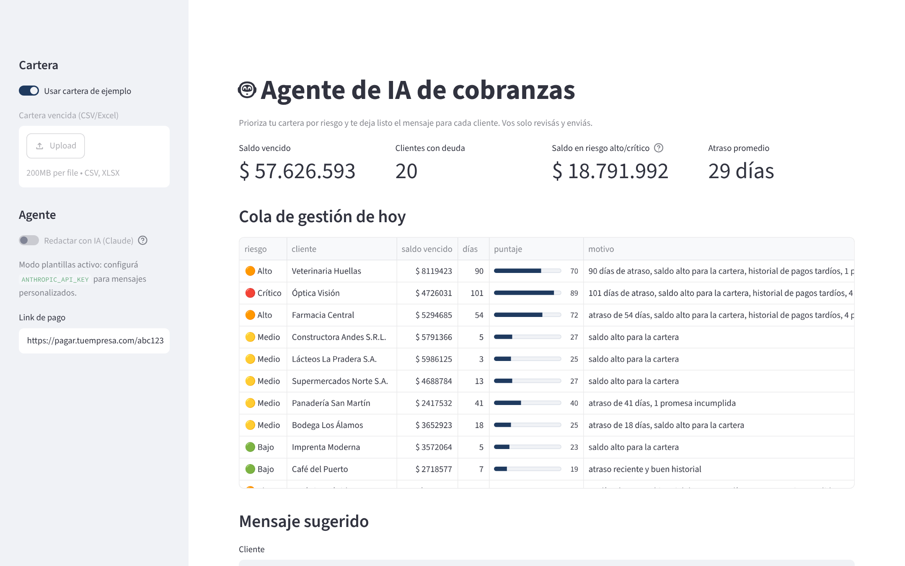
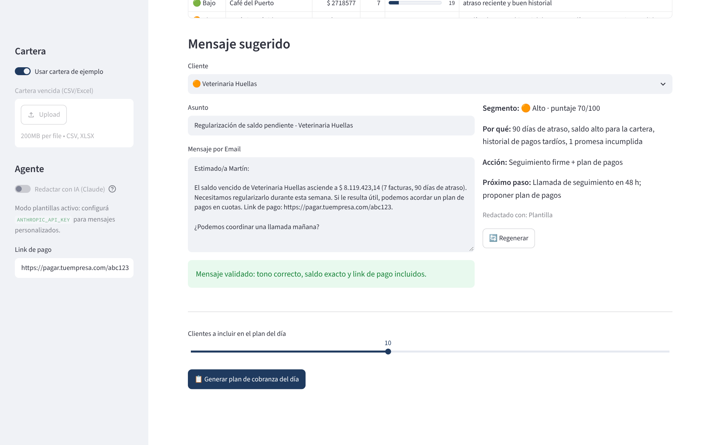

# 🤖 Agente de IA de cobranzas

**Prioriza tu cartera vencida por riesgo y te deja listo el mensaje para cada cliente.** Vos solo revisás y enviás.

Lo diseñó un analista senior de créditos y cobranzas con más de 10 años de experiencia. La IA redacta, pero las reglas de negocio deciden: cada mensaje se valida antes de llegar a tus manos.



## El problema

Cada mañana el equipo de cobranzas mira una planilla con 200 clientes vencidos y tiene que decidir **a quién llamar primero y qué decirle**. Termina persiguiendo al que más grita, mandando el mismo mensaje genérico a todos o, peor, siendo demasiado duro con un buen cliente que se atrasó una semana.

## Cómo funciona

```
Cartera vencida ──► 1. Scoring de riesgo ──► 2. Priorización ──► 3. Agente redactor ──► 4. Validación ──► Plan del día
                    (atraso, monto,          (riesgo × $)        (Claude o plantilla)   (tono, saldo,
                     historial, promesas)                                                 link, largo)
```

### 1. Scoring de riesgo transparente (0-100)

| Factor | Peso | Qué mide |
|---|---|---|
| Días de atraso | 40% | Cuánto hace que está vencido (satura a los 120 días) |
| Saldo vencido | 25% | Cuánta plata hay en juego, comparada con el resto de la cartera |
| Historial de pago | 20% | Atraso promedio histórico del cliente |
| Promesas incumplidas | 15% | Cuántas veces dijo "el viernes te pago" y no pagó |

Cada cliente tiene una **explicación en lenguaje natural** ("90 días de atraso, historial de pagos tardíos, 1 promesa incumplida"), así el equipo entiende por qué está arriba en la lista.

### 2. Segmentos y estrategia

| Segmento | Puntaje | Estrategia |
|---|---|---|
| 🟢 Bajo | 0-24 | Recordatorio amable, cuidando la relación comercial |
| 🟡 Medio | 25-49 | Recordatorio con el detalle de la deuda y link de pago |
| 🟠 Alto | 50-74 | Seguimiento firme con fecha concreta y opción de plan de pagos |
| 🔴 Crítico | 75-100 | Escalamiento: llamada del responsable y evaluación de suspender crédito |

### 3. Agente redactor

- **Con IA:** Claude recibe el contexto del cliente y la estrategia, y devuelve un JSON con acción, asunto, mensaje y próximo paso. Respeta el canal: WhatsApp corto y cercano, email formal con asunto.
- **Sin IA:** plantillas por segmento y por canal. Funciona sin clave de API, sin costo y sin conexión.

### 4. Validación (guardrails)

Ningún mensaje de la IA llega al usuario sin pasar estos controles:

- ❌ Nada de amenazas ni menciones a juicios, embargos o Veraz.
- ✅ Tiene que mencionar el **saldo exacto**.
- ✅ Tiene que incluir el **link de pago**.
- ✅ Respeta el largo máximo del canal (450 caracteres en WhatsApp y 900 en email).

Si la IA falla o su mensaje no pasa la validación, el agente **vuelve automáticamente a la plantilla** y registra el motivo. La cobranza nunca se frena.



## Cómo usarlo

```bash
git clone https://github.com/varelajm10/agente-cobranzas-ia.git
cd agente-cobranzas-ia
pip install -r requirements.txt

# App web (modo plantillas)
streamlit run app.py

# Con IA
export ANTHROPIC_API_KEY=sk-ant-...
export CLAUDE_MODEL=claude-sonnet-4-5   # opcional
streamlit run app.py

# Línea de comandos: plan de los 10 clientes prioritarios
python cli.py --demo --top 10
python cli.py --cartera cartera.xlsx --salida plan_cobranza.csv
```

Salida de la línea de comandos con la cartera de ejemplo:

```
  Modo: plantillas  ·  Cartera: 20 clientes
  Saldo vencido total: $ 57,626,594
  Bajo: 9  ·  Medio: 7  ·  Alto: 3  ·  Crítico: 1

  Top 8 de hoy:
    1. [Alto   ] Veterinaria Huellas            Email    → Seguimiento firme + plan de pagos
    2. [Crítico] Óptica Visión                  WhatsApp → Escalamiento a responsable
    3. [Alto   ] Farmacia Central               WhatsApp → Seguimiento firme + plan de pagos
    ...
```

### Formato de la cartera

`cliente`, `contacto`, `canal` (WhatsApp/Email), `saldo_vencido`, `dias_atraso`, `facturas_vencidas`, `atraso_promedio_hist`, `promesas_incumplidas`

Se arma fácil desde un aging de SAP, Tango, Odoo o cualquier ERP.

## Tests

```bash
pytest -q   # 16 tests: scoring, segmentos, guardrails, respaldo ante errores de la IA y plan del día
```

Los tests del agente usan un cliente de IA simulado, así que corren sin clave y sin internet.

## Estructura

```
agente/
  riesgo.py     # scoring, segmentación y explicación
  redactor.py   # agente: prompt, llamada a Claude, validación y plantillas de respaldo
  demo.py       # cartera de ejemplo (100% inventada)
app.py          # interfaz web en Streamlit
cli.py          # plan del día por línea de comandos
tests/
```

## Próximos pasos posibles

- Envío directo por la API de WhatsApp Business o por email (SMTP o Gmail).
- Registro de promesas de pago y actualización automática del historial.
- Conexión con el [motor de conciliación bancaria](https://github.com/varelajm10/conciliacion-bancaria) para sacar de la cola a quien ya pagó.

## Stack

Python · pandas · Anthropic API (Claude) · Streamlit · pytest

---

**¿Querés esto conectado a tu ERP y a tu WhatsApp?** Lo adapto a tu cartera y a tus políticas de crédito.
Juan Manuel Varela · [Malt](https://www.malt.com/profile/juanmanuelvarela) · [Upwork](https://www.upwork.com/freelancers/~018e401f66a51ddd08) · [GitHub](https://github.com/varelajm10)

<sub>Los datos de ejemplo son ficticios: cualquier parecido con empresas o personas reales es coincidencia.</sub>
